# Heart Disease Prediction: MLOps Assignment 1

Author: `2025ae05142`

Course: AIMLCZG523  
Repository: [bheemreddy1729/heart-disease-prediction](https://github.com/bheemreddy1729/heart-disease-prediction)

## Demonstration video

[Watch the pipeline demonstration on Google Drive](https://drive.google.com/file/d/1-wEoLDfVbTFAlR3ZZ06UIUIfSedHGWc4/view?usp=sharing).

## Executive summary

This project implements a reproducible machine-learning workflow for the
processed Cleveland subset of the UCI Heart Disease dataset. It prepares and
profiles the data, compares three classifiers with leakage-safe cross-validation,
tracks model experiments locally with MLflow, packages a calibrated serving
pipeline, exposes predictions through a FastAPI endpoint, and runs that API in
a local Minikube deployment. GitHub Actions checks the code and reproduces the
training workflow. Prometheus metrics, privacy-conscious request logs, and a
Grafana dashboard provide operational visibility.

Every stage was run on the BITS Prayogshala Linux VM, the hosted CI workflow
passed, and the local Kubernetes service returned predictions; the repository
holds the records for each step. This is coursework, not a clinically
validated model (see Section 10).

I used GitHub Copilot as a coding assistant for parts of the code and
documentation. I ran every step on the VM myself and reviewed the outputs
reported here.

## 1. Scope and reproducible environment

The objective was to connect data processing, model development, packaging,
serving, testing, CI, deployment, and monitoring into one traceable workflow
without requiring cloud accounts. Implementation and runtime validation were
performed on the BITS Prayogshala Linux VM as user `s2025ae05142`, in the
repository at `/home/s2025ae05142/workspace/Assignment-I/heart-disease-prediction`.
The VM had Python 3.12.9, Docker 28.0.1, and Minikube 1.35.0, but no
standalone `kubectl`; deployment commands used the compatible client bundled
with Minikube.

The following sequence follows the repository's [README](../README.md). It
creates an isolated Python environment, installs the pinned dependencies,
checks dependency consistency, regenerates the data and reports, trains and
packages the model, then exercises the sample inference command:

```sh
python3 -m venv .venv
.venv/bin/python -m pip install -r requirements.txt
.venv/bin/python -m pip check
.venv/bin/python src/data/download_heart.py
.venv/bin/python src/data/prepare.py
.venv/bin/python src/eda/explore.py
.venv/bin/python src/train/train.py
.venv/bin/python -m src.train.package
.venv/bin/python -m src.infer.predict --input examples/patient.json
```

The documented inference result is a JSON list. Each item has an integer
`prediction` (`0` for absent or `1` for present) and a floating-point
`confidence`, defined as the probability assigned to the predicted class. The
sample input is a feature-only dataset record, not an independent test case.
The model artifact is generated locally and is intentionally not checked into
the repository. Only trusted locally generated joblib/MLflow artifacts should
be loaded because serialized Python objects can execute code.

## 2. Dataset and exploratory analysis

The data source is the [UCI Heart Disease processed Cleveland dataset](https://archive.ics.uci.edu/ml/machine-learning-databases/heart-disease/processed.cleveland.data),
using the processed Cleveland file. It contains 303 patient records, 13
clinical feature columns, and the original `num` outcome. Preparation maps
`num=0` to absence (`0`) and original values `1` through `4` to presence (`1`).
The source's `?` values are retained as missing rather than dropping records or
estimating values during EDA. The file was downloaded on 2026-10-15 by
`src/data/download_heart.py`.

The target distribution is 164 absent and 139 present records. Six feature
cells are missing: four in `ca` and two in `thal`; the other reported columns
have no missing cells. The [EDA summary](../reports/eda_summary.md) records
these counts and the generated figures. Histograms omit missing values for
each individual feature, and the correlation calculation uses pairwise
complete observations. These choices keep the complete source cohort visible
without allowing imputation statistics to use data before model validation.

For modelling, five measurements (`age`, `trestbps`, `chol`, `thalach`, and
`oldpeak`) are treated as continuous numeric features. Eight coded features
(`sex`, `cp`, `fbs`, `restecg`, `exang`, `slope`, `ca`, and `thal`) are treated
as categorical values. The reasoning behind these and later choices is in the
[README design decisions](../README.md#design-decisions).

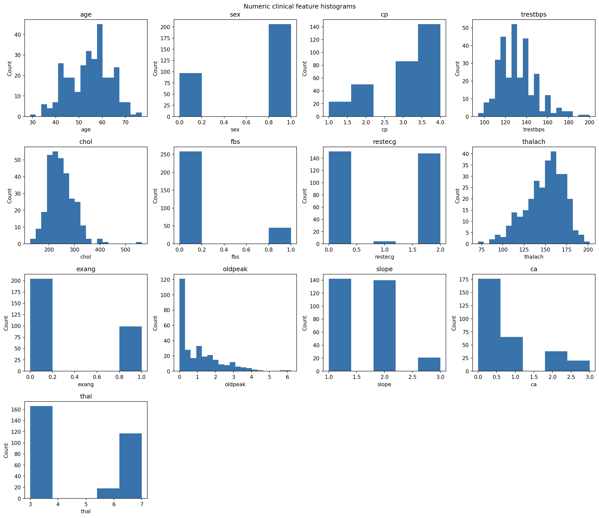

*Phase 1: distributions of the numeric clinical features, excluding missing
values per feature.*

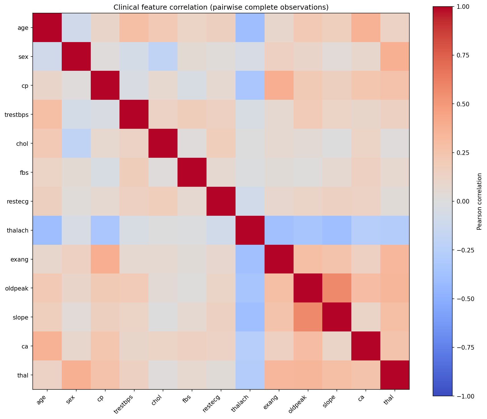

*Phase 1: correlations calculated using pairwise complete observations.*

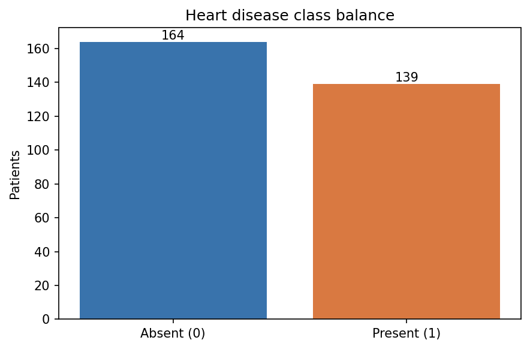

*Phase 1: target counts after mapping the original outcome to binary labels.*

## 3. Candidate models and validation

Three model families were compared: Logistic Regression, Random Forest, and an
RBF-kernel Support Vector Classifier. Logistic Regression provides a regularized
linear baseline, Random Forest can represent nonlinear splits and interactions,
and the RBF SVC tests a smooth nonlinear boundary. Together they cover three
quite different decision structures on a small tabular dataset.

Each candidate is evaluated through a scikit-learn pipeline. Continuous
features use median imputation and standardization. Categorical features use
most-frequent imputation followed by one-hot encoding, with unknown categories
ignored at inference. These transformations are fit within each training fold,
not on the full dataset before validation. Five-fold stratified cross-validation
uses shuffling and `random_state=42`; accuracy, precision, recall, and ROC-AUC
are reported as fold means and sample standard deviations.

The project prioritizes mean recall because missed positive cases are the
primary screening error of concern. Mean ROC-AUC and then mean precision break
recall ties; accuracy is reported but does not determine the winner. By that
rule, `rbf_svc` is the champion:

| Candidate | Accuracy | Precision | Recall | ROC-AUC |
|---|---:|---:|---:|---:|
| Logistic Regression | 0.8547 ± 0.0542 | 0.8744 ± 0.0640 | 0.7979 ± 0.0812 | 0.9188 ± 0.0232 |
| Random Forest | 0.8384 ± 0.0310 | 0.8505 ± 0.0612 | 0.7913 ± 0.0306 | 0.9144 ± 0.0255 |
| RBF SVC | 0.8448 ± 0.0506 | 0.8501 ± 0.0666 | 0.8056 ± 0.0656 | 0.9021 ± 0.0319 |

These are cross-validation estimates; there is no separate held-out test set.
The complete comparison and champion rule are in
[model_comparison.md](../reports/model_comparison.md).

### Hyperparameter tuning and deployment decision

After the initial model-family comparison, a bounded RBF SVC tuning experiment
evaluated nine combinations: `C` in `{0.1, 1, 10}` and `gamma` in
`{"scale", 0.01, 0.1}`. This grid explores regularization strength and kernel
width, including the original `C=1, gamma="scale"` baseline. All configurations
used the same five shuffled stratified folds, seed 42, and fold-local
preprocessing. Selection followed the existing recall-first rule, with ROC-AUC
and precision as tie-breakers. The separate local MLflow experiment
`heart-disease-tuning-2025ae05142` contains the completed runs, parameters,
metrics, comparison plot, and report.

| Uncalibrated RBF SVC configuration | Accuracy | Precision | Recall | ROC-AUC |
|---|---:|---:|---:|---:|
| Original: C=1, gamma=scale | 0.844754 | 0.850069 | 0.805556 | 0.902143 |
| Tuning winner: C=1, gamma=0.1 | 0.848033 | 0.851656 | 0.812698 | 0.901927 |

Values are CV means; standard deviations, all configurations, and actual run
IDs appear in [the tuning summary](../reports/tuning_summary.md). The selected
configuration's run ID is `05e2a3643a7444788a4945f2e8d6b9ad`. Its recall mean
increased by `0.007143`, while ROC-AUC decreased by `0.000216`, calculated from
unrounded results. Because tuning reuses the same data, this is a small
selection gain rather than proof of better generalization.

I decided to keep the existing calibrated baseline in production. The tuning
winner has not been calibrated, packaged, or promoted, and a gain this small
on reused data did not justify replacing an artifact that had already passed
every downstream check. Note that the tuning scores above are uncalibrated and
are not comparable with the calibrated diagnostics in Section 4.

## 4. Experiment tracking and packaged confidence

Training writes MLflow runs to a repository-local SQLite tracking and registry
store, with model files and figures in a local artifact directory. This keeps
the experiment workflow usable without a hosted tracking service. The latest
recorded successful candidate batch and champion registry version are
summarized in [mlflow_summary.md](../reports/mlflow_summary.md):

| Model | Run ID | Logged model URI |
|---|---|---|
| Logistic Regression | `e31403f4bb7d4506b39ceb1ff05004c4` | `models:/m-b5fd21e8ba934af496d60383792f11d2` |
| Random Forest | `278a020c22ae4530aabafb6bd5fc1307` | `models:/m-01a5af4d0b6c48ce82d5cea6cbb03c72` |
| RBF SVC | `5ad5e00bd4714b998beb1b868379a2b2` | `models:/m-bfd6e6c8994c44298d525deb69be3746` |

The experiment records include author attribution, data identity, model and
preprocessing parameters, validation metrics, fitted pipelines, and EDA
artifacts. The uncalibrated candidate champion is registered as
`heart-disease-champion-2025ae05142`, version 2. This registry model and the
calibrated serving artifact are separate: the serving artifact does not
overwrite or relabel the registry candidate's metrics.

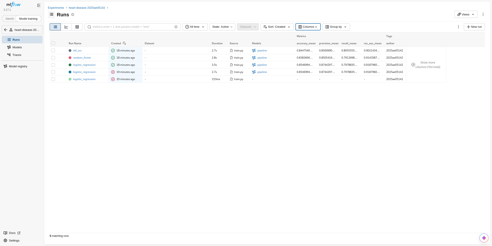

*Phase 3 historical capture: candidate runs, validation metrics, author tags,
and retained failed attempts. The table above describes the later successful
batch, not the run IDs in this earlier capture.*

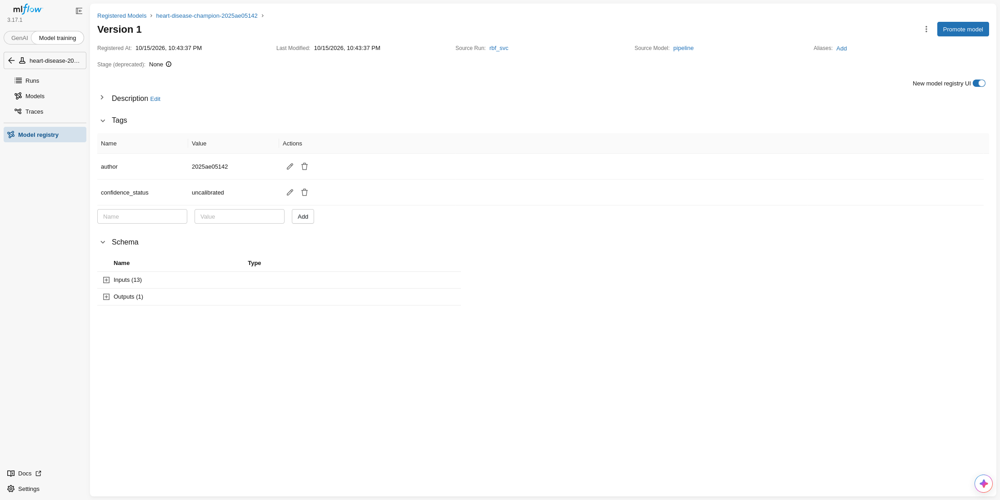

*Phase 3 historical capture: registry version 1, tagged as uncalibrated.
The later batch summarized above registered version 2; neither registry
version is the separate calibrated serving artifact.*

For serving probabilities, packaging wraps the selected full preprocessing
and classifier pipeline in a sigmoid `CalibratedClassifierCV`. The recorded
evaluation uses five outer stratified folds and five inner calibration folds,
with shuffling and seed 42. After out-of-fold evaluation, the final pipeline
is fit on all 303 records and saved with provenance. The
[calibration summary](../reports/calibration_summary.md) reports pooled
out-of-fold accuracy `0.854785`, precision `0.851852`, recall `0.827338`,
ROC-AUC `0.905115`, Brier score `0.121745`, log loss `0.392889`, and a
training-fold prevalence baseline Brier score of `0.248313`.

These diagnostics are post-selection, since the same data chose the model.
Inference predicts class 1
when disease probability is greater than `0.5`; otherwise it predicts class
0. An exact tie at `0.5` returns class 0 because the validated class order is
`[0, 1]`. The returned confidence is the probability of the chosen class, not
certainty.

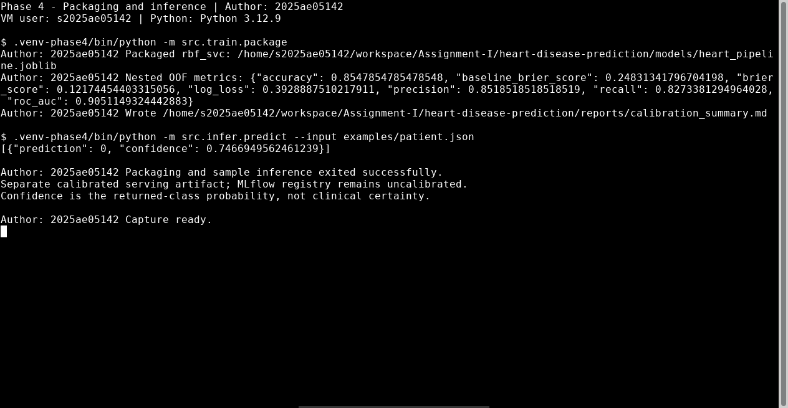

*Phase 4: packaging diagnostics and the sample CLI prediction from the separate
calibrated serving pipeline.*

## 5. System architecture

The data, experiment, packaging, deployment, and monitoring paths are separated
so the serving container does not download data, train a model, or access
MLflow at startup.

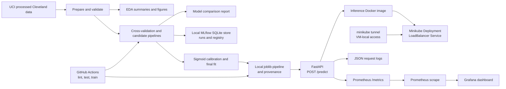

Training happens outside the cluster; Minikube only runs the serving image, and
MLflow is not needed at serving time.

## 6. API and container

The FastAPI application exposes `GET /health` and `POST /predict`. The prediction
endpoint accepts the same feature-only JSON list used by local inference and
returns prediction/confidence pairs. Invalid request records are rejected with
HTTP 422. The inference-only Docker image includes the generated model artifact
and serving dependencies, runs as unprivileged UID 10001, and is bound to
loopback for the recorded local smoke test.

On the VM, the Phase 6 image build succeeded. `GET /health` returned
`{"status":"ok"}` and a `POST /predict` using `examples/patient.json` returned
`[{"prediction":0,"confidence":0.7466949562461239}]`. The recorded container
ran as user `app` (UID 10001), and the temporary smoke-test container was
stopped and removed after verification. The commands are in the
[README Docker section](../README.md#http-api-and-docker).

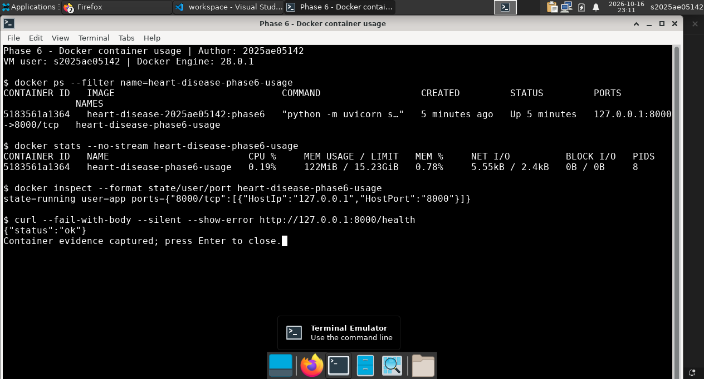

*Phase 6: running container, loopback port mapping, non-root user, and health
response. This is the original container smoke evidence, not the later
instrumented Kubernetes deployment.*

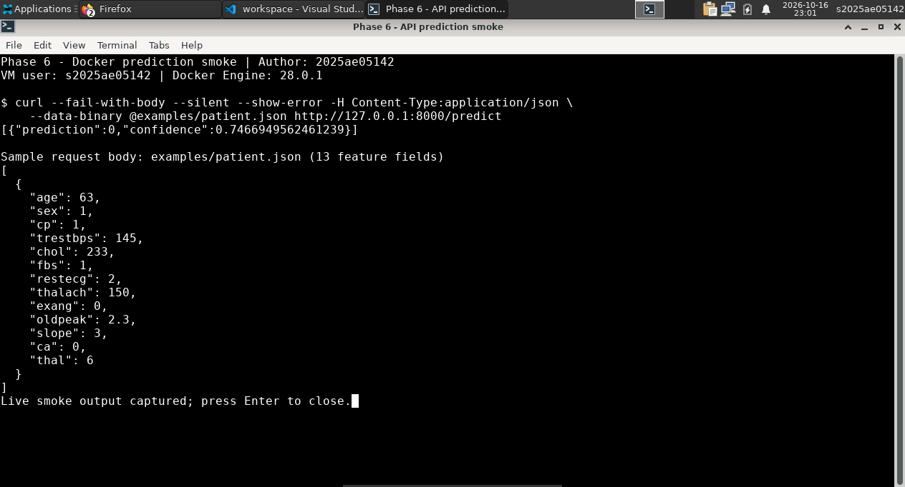

*Phase 6: sample feature-only JSON body and the prediction returned through
the container's published port.*

## 7. Kubernetes deployment

The deployment uses a single-node local Minikube cluster with the Docker driver.
The locally built image is loaded into the cluster rather than pulled from a
public registry. A namespace, one-replica Deployment, and LoadBalancer Service
provide local API access through `minikube tunnel`; health probes use `/health`.
The Service keeps nodePort `30080` as an extra route. My first deployment used
NodePort only; I switched to LoadBalancer after rechecking the assignment,
which asks for a Load Balancer or Ingress.

The corrected deployment was verified on the current VM with `minikube tunnel`
running. Its LoadBalancer external address was `10.97.154.192`; health returned
`{"status":"ok"}` and sample prediction returned
`[{"prediction":0,"confidence":0.7466949562461239}]`.
The API pod was ready with zero restarts and the retained NodePort route still
worked. The address is local to the VM, not a public cloud endpoint. To
reproduce local access, follow the
[Kubernetes steps in the README](../README.md#kubernetes-on-minikube), keeping
the tunnel running.

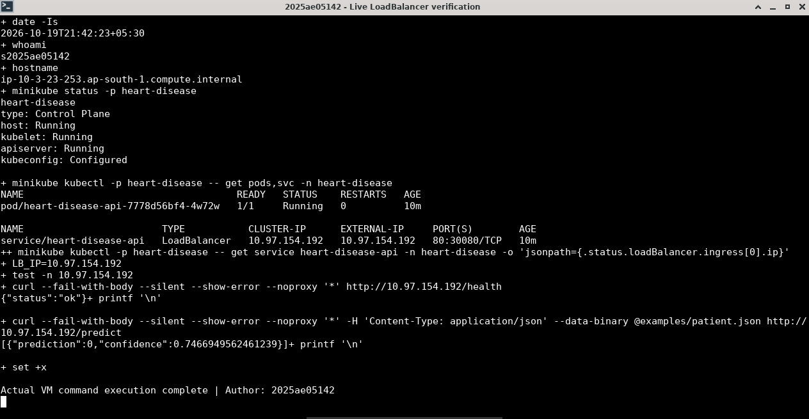

The terminal capture above shows the ready API pod, LoadBalancer
external address, health response, and prediction. The additional
[tunnel and request-log capture](../screenshots/phase-7-loadbalancer-tunnel.png)
shows the running local tunnel, route, sample request, and attributed event.

## 8. CI, testing, and reproducibility

The GitHub Actions workflow in `.github/workflows/ci.yml` has separate `lint`,
`test`, and `train` jobs. The hosted train job reproduces processing and EDA
from the committed raw data, evaluates and tracks the model candidates,
packages the calibrated serving model, verifies outputs, and uploads a
training evidence artifact. The test suite builds test artifacts in temporary
locations rather than relying on ignored model or MLflow files. Ruff and the
full pytest suite also passed locally on the VM.

The project includes a deliberate CI failure and its recovery: an explicitly
added assertion
[failed in run 38789263010](https://github.com/bheemreddy1729/heart-disease-prediction/actions/runs/38789263010),
then the workflow
[returned to green in run 38789471935](https://github.com/bheemreddy1729/heart-disease-prediction/actions/runs/38789471935)
after that test was reverted. Later, an initial Phase 8
[hosted run](https://github.com/bheemreddy1729/heart-disease-prediction/actions/runs/38952933435)
exposed a clean-runner test dependency on an ignored local model artifact; I
changed the test to use an isolated fixture. The
[next hosted run](https://github.com/bheemreddy1729/heart-disease-prediction/actions/runs/38955767909)
completed successfully on `main`. GitHub reports successful `lint`, `test`,
and `train` jobs, and the training evidence artifact
`training-evidence-2025ae05142` was uploaded.

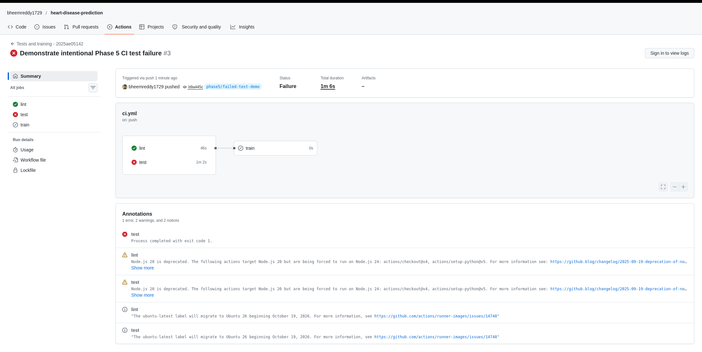

*Phase 5 historical run 38789263010: lint passed, the intentional test failed,
and dependent training was skipped.*

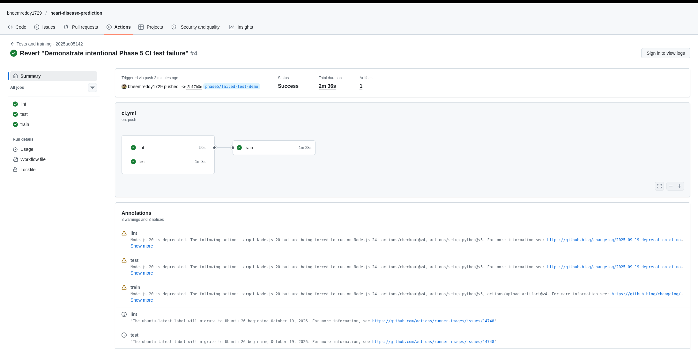

*Phase 5 historical recovery run 38789471935: lint, test, and train passed,
with one uploaded artifact.*

## 9. Monitoring and request privacy

The API emits one JSON log event per `POST /predict`, including UTC timestamp,
feature names, prediction, confidence, latency, and the author tag. Feature
values and free-text bodies are not logged. Invalid bodies are logged with
empty feature names and null prediction/confidence. The Prometheus client
exposes a request counter and latency histogram without patient data or
request-specific labels.

Prometheus scrapes the API every 15 seconds. The provisioned Grafana dashboard
shows request rate, latency percentiles, and total requests. In the recorded
Phase 8 deployment, the API, Prometheus, and Grafana pods were each `1/1
Running` with zero restarts. The live API returned HTTP 200 for the sample and
HTTP 422 for invalid requests; request counters and histogram observations
increased as expected. Prometheus reported the API target up with no scrape
error, and Grafana loaded the provisioned dashboard. The review-correction
validation checked a valid request, malformed JSON, and a missing body, with
the counter and histogram each increasing exactly once per request. The
[README monitoring section](../README.md#monitoring-and-logging) has the
deployment and access commands.

After the LoadBalancer correction, the existing Prometheus/Grafana workloads
were restored and reverified on the current VM. All three pods were ready with
zero restarts, the scrape target was up, and valid and rejected requests each
incremented the API counter and latency observation exactly once. No monitoring
code change was needed because the internal Service scrape address stayed the
same.

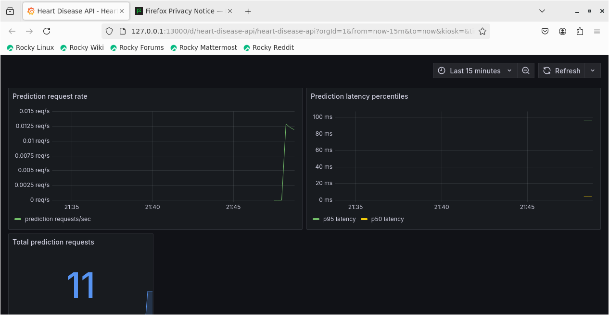

## 10. Limitations and responsible interpretation

This project is an educational MLOps exercise, not a medical device. The
dataset is a small processed subset, validation is cross-validation on the
same data used for candidate selection, and no independent clinical cohort or
prospective study is reported. Performance numbers are not guarantees for
other populations, care settings, or future patients. Calibration diagnostics
are also post-selection estimates, not proof of clinical calibration.

The fixed probability threshold is a project decision, not a clinically
optimized operating point. A prediction or confidence value must not be used
as a diagnosis, treatment recommendation, or substitute for a qualified
clinician. Further work would require appropriately governed data, independent
evaluation, clinical review, security/privacy review, and validation under the
intended deployment conditions. Those activities are outside this assignment's
verified scope.

## Evidence index

- [Design decisions and data source](../README.md#design-decisions)
- [EDA summary and figures](../reports/eda_summary.md)
- [Model comparison](../reports/model_comparison.md)
- [Hyperparameter tuning results](../reports/tuning_summary.md)
- [MLflow run summary](../reports/mlflow_summary.md)
- [Calibration diagnostics](../reports/calibration_summary.md)
- [Screenshots folder](../screenshots/)
- [Kubernetes and monitoring setup](../README.md#kubernetes-on-minikube)
- [GitHub Actions run history](https://github.com/bheemreddy1729/heart-disease-prediction/actions)
