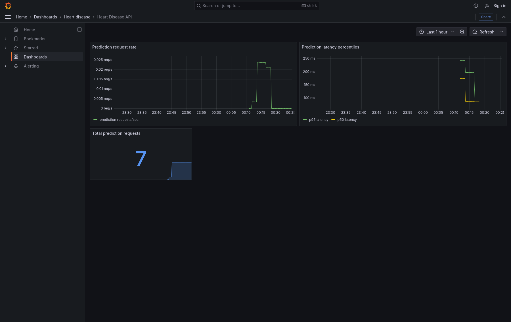

# Phase 8: Monitoring and logging

Author: `2025ae05142`

## Deployment and access

Validated on the BITS Prayogshala Linux VM as `s2025ae05142`, in the
`heart-disease` Minikube cluster. The instrumented API image is
`heart-disease-2025ae05142:phase8-review`; Prometheus uses `prom/prometheus:v2.55.1`
and Grafana uses `grafana/grafana:11.4.0`. The API remains available through
the Phase 7 NodePort at `http://192.168.49.2:30080`.

The monitoring Services are ClusterIP-only. To access their UIs from the VM,
run each command in a separate terminal and keep the port-forward running:

```sh
minikube kubectl -p heart-disease -- port-forward --address=127.0.0.1 \
  service/prometheus 19090:9090 -n heart-disease
minikube kubectl -p heart-disease -- port-forward --address=127.0.0.1 \
  service/grafana 13000:3000 -n heart-disease
```

Grafana's admin password is held only in the Kubernetes Secret
`grafana-admin`; it is not stored in this repository. Anonymous access is
read-only. Do not publish the port-forward or commit the Secret.

## Telemetry contract

- Each `POST /predict` emits one JSON log event with author, UTC timestamp,
  feature names only, prediction, confidence, and latency in milliseconds.
  Invalid feature requests are logged with null prediction/confidence. Missing
  or malformed JSON bodies are handled before the endpoint and are also logged
  once with empty feature names and null prediction/confidence; values from the
  request body are not logged.
- `GET /metrics` exposes
  `heart_disease_prediction_requests_total` and the
  `heart_disease_prediction_request_duration_seconds` histogram. The metrics
  have no patient data or request-specific labels.
- Prometheus scrapes
  `heart-disease-api.heart-disease.svc.cluster.local:80/metrics` every 15
  seconds. The provisioned Grafana dashboard shows request rate, p50/p95
  latency, and total request count.

## Live smoke evidence

The API health endpoint returned:

```sh
curl --fail-with-body --silent --show-error \
  http://192.168.49.2:30080/health
```

```json
{"status":"ok"}
```

A real sample request used the repository's feature-only sample body:

```sh
curl --fail-with-body --silent --show-error \
  -H 'Content-Type: application/json' \
  --data-binary @examples/patient.json \
  http://192.168.49.2:30080/predict
```

```json
[{"prediction":0,"confidence":0.7466949562461239}]
```

Five further valid requests and one invalid `{}` request returned five HTTP
200 responses and one HTTP 422. The API pod log contained seven JSON events
for the seven total requests (six successful, one invalid), each with exactly
the documented fields and author tag; the invalid event had null prediction
and confidence. The logged feature field contained names only. Automated API
tests additionally exercise malformed JSON and a missing body, confirming each
gets one event, one request-counter increment, and one histogram observation.

After Prometheus's next 15-second scrape, its active target reported `health:
up` with an empty `lastError`. Querying
`heart_disease_prediction_requests_total` returned `7`; the API's live
histogram also reported count `7`. Grafana `/api/health` returned database
`ok`, version `11.4.0`; the provisioned dashboard was searchable as
`heart-disease-api`.

The screenshot was taken from the live Grafana UI after all three panels had
rendered and showed total request count `7`:



The review-correction request cases were also exercised against the live VM
API in Swagger UI (valid and malformed JSON) and a browser form that submitted
an actually empty body. Each request incremented the API counter exactly once:

- [Valid prediction: HTTP 200 and response](../screenshots/phase-8-valid-request.png)
- [Malformed JSON: HTTP 422 validation response](../screenshots/phase-8-malformed-json.png)
- [Missing request body: live server validation response](../screenshots/phase-8-missing-body.png)

## Resource gate

### Review-correction verification

The corrected image was built as
`heart-disease-2025ae05142:phase8-review` (image ID
`sha256:427cfad548db527c26ed9b20d82e9427b51dad5404efb695f2e15a02b4fce92b`)
and rolled out to the VM's Minikube Deployment. Through the NodePort, a
successful sample returned HTTP 200, malformed JSON returned HTTP 422, and a
missing body returned HTTP 422. Across those three requests, the API counter
and histogram count each increased from 0 to 3. The API pod emitted exactly
three JSON lines: one prediction event and two rejected-body events with empty
feature lists and null prediction/confidence. After the next scrape,
Prometheus reported the API target `up`, no scrape error, and request counter
`3`.

At validation, `free -h` reported 15 GiB total and 9.8 GiB available on the VM.
The Minikube node had 4 CPUs and 15,968,384 KiB memory. `kubectl describe
node heart-disease` reported total workload requests of 1,050m CPU and 938Mi
memory (26% and 6% of node capacity); limits were 3 CPUs and 2,730Mi. The
Prometheus and Grafana pods each request 100m CPU/256Mi and are limited to 1
CPU/768Mi. Both use ephemeral storage with explicit size limits.

The `kubectl top nodes` Metrics API was unavailable, so no live usage figure
from that API is claimed. Capacity and scheduled requests were verified with
`free -h` and `minikube kubectl -p heart-disease -- describe node heart-disease`.

## Reproduction outline

Run on the VM from the repository root. Generate the locally ignored model
artifact before building the image. Create/update the ConfigMaps from the
checked-in monitoring files, ensure the `grafana-admin` Secret exists without
placing its password in source control, and then apply the workloads:

```sh
.venv-phase4/bin/python -m src.train.package
docker build --tag heart-disease-2025ae05142:phase8-review .
minikube image load --profile=heart-disease heart-disease-2025ae05142:phase8-review
minikube kubectl -p heart-disease -- create configmap prometheus-config \
  -n heart-disease --from-file=prometheus.yml=monitoring/prometheus.yml \
  --dry-run=client -o yaml | minikube kubectl -p heart-disease -- apply -f -
minikube kubectl -p heart-disease -- create configmap grafana-datasource \
  -n heart-disease --from-file=grafana-datasource.yaml=monitoring/grafana-datasource.yaml \
  --dry-run=client -o yaml | minikube kubectl -p heart-disease -- apply -f -
minikube kubectl -p heart-disease -- create configmap grafana-dashboard-provider \
  -n heart-disease --from-file=grafana-dashboard-provider.yaml=monitoring/grafana-dashboard-provider.yaml \
  --dry-run=client -o yaml | minikube kubectl -p heart-disease -- apply -f -
minikube kubectl -p heart-disease -- create configmap grafana-dashboard \
  -n heart-disease --from-file=heart-disease-dashboard.json=monitoring/heart-disease-dashboard.json \
  --dry-run=client -o yaml | minikube kubectl -p heart-disease -- apply -f -
minikube kubectl -p heart-disease -- apply -f k8s/deployment.yaml -f k8s/monitoring.yaml
minikube kubectl -p heart-disease -- rollout status deployment/heart-disease-api \
  -n heart-disease --timeout=180s
minikube kubectl -p heart-disease -- rollout status deployment/prometheus \
  -n heart-disease --timeout=180s
minikube kubectl -p heart-disease -- rollout status deployment/grafana \
  -n heart-disease --timeout=180s
```

At validation, all three pods were `1/1 Running` with zero restarts. The API
was rebuilt with the Phase 8 tag and successfully rolled out. A controlled
Grafana restart briefly invalidated its existing port-forward; the forward
was re-established and the dashboard recaptured after Grafana returned
healthy. Final lint and test checks are recorded in
[phase progress](./PROGRESS.md).
