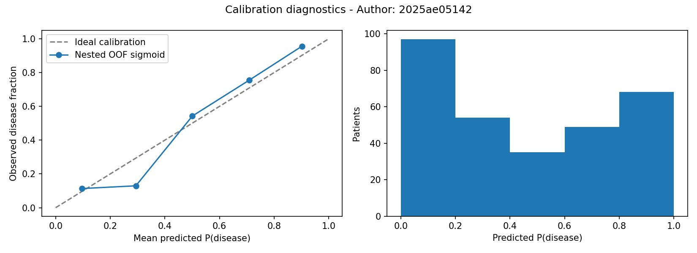

# Confidence pipeline diagnostics - Author: `2025ae05142`

- Selected candidate: `rbf_svc` using the established CV champion rule.
- Data: 303 rows; SHA-256 `655b46ed75efcb7eb0f636b952f6ed68c6bf48487c6dbde7070ade6a3d5390d8`.
- Evaluation: 5 outer stratified folds, each with 5 inner sigmoid calibration folds; shuffled, seed 42. Preprocessing stays inside each inner estimator.
- Scores below are pooled outer out-of-fold diagnostics, not the original uncalibrated model's fold-mean comparison.
- Candidate selection used the same dataset; these post-selection diagnostics are not an unbiased independent test, clinical validation, or guarantee of calibration.

| Metric | Value |
|---|---:|
| accuracy | 0.854785 |
| precision | 0.851852 |
| recall | 0.827338 |
| roc_auc | 0.905115 |
| brier_score | 0.121745 |
| log_loss | 0.392889 |
| baseline_brier_score | 0.248313 |

Brier score and log loss are lower-is-better. The baseline uses only each outer training fold's disease prevalence; the reliability plot compares predicted probabilities to observed frequencies and shows bin counts. Small bins are uncertain.

- Final artifact: `models/heart_pipeline.joblib`, fit on 303 rows after OOF evaluation.
- Artifact SHA-256: `e9e7aee665648300c2eac5a917cca89a2c401f9c32a881a65e5c20df99d0fc4c`.
- Provenance: `models/heart_pipeline.json`; regenerate both with `python -m src.train.package`.
- Inference returns the probability of the predicted class as confidence. It is not certainty, a diagnosis, or a decision threshold chosen for clinical use.
- Decision rule: predict 1 when P(disease) > 0.5; otherwise predict 0. An exact tie at 0.5 returns class 0 with confidence 0.5 because argmax selects the first class in [0, 1].
- The existing MLflow registered version remains the uncalibrated Phase 3 model; this separate local confidence artifact does not change its recorded metrics.
